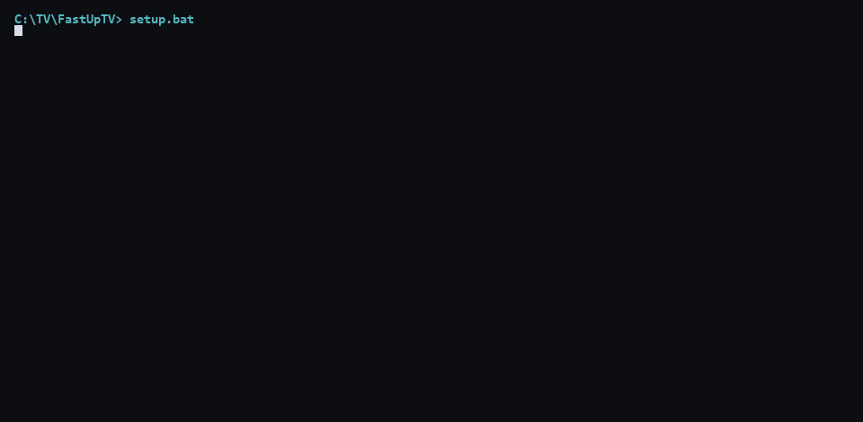

# FastUpTV

[](#requirements)
[](#supported-tvs)
[](LICENSE)
[](#safety)
[](https://github.com/dualwarez/FastUpTV/releases)

**Double-click one .bat. Your slow Android TV becomes fast, clean and ad-free. No root, no cable, no AI assistant.**

```
   BEFORE                                        AFTER
   PatchWall + ad rows                           a 470 KB home screen
   91 MB of vendor bloat in RAM                  that RAM back
   1522 ms to open YouTube                       950 ms
```

FastUpTV finds your TV on Wi-Fi, backs it up, disables the vendor bloat, installs a featherweight
home screen and tunes the system - all from one file a non-technical person can run.



<sub>Static copy for slow connections: [`docs/screenshot-setup.png`](docs/screenshot-setup.png)</sub>

---

## Quick start

**On the TV (once, 60 seconds)**

1. Settings -> About -> press **OK 7 times** on *Build* -> "You are now a developer"
2. Settings -> Developer options -> **USB debugging** ON
3. Leave the TV on, on the same Wi-Fi as the PC

**On the PC**

```
Double-click  setup.bat
```

Press **Home** on the remote. That is the whole tutorial.

Something wrong? `restore.bat` puts everything back.

**No PC?** Run it from your phone with Termux - see [mobile/README.md](mobile/README.md).

```
pkg install android-tools
bash mobile/setup.sh
```

---

## The numbers (measured, not marketing)

On a Xiaomi Mi TV 4A 40" (Android 9, 1 GB RAM), before and after:

| | Before | After |
|---|---|---|
| YouTube cold start | 1522 ms | **950 ms** |
| RAM held by vendor bloat | 91 MB | **0** |
| Free storage | 2.8 GB used | **2.1 GB used** (700 MB freed) |
| Packages disabled | 0 | **30** |
| Home screen | PatchWall + ads | 470 KB launcher, zero ads |

Your TV will differ - the tool prints its own before/after at the end.

---

## What it does

| Step | What happens |
|---|---|
| **1. Finds the TV** | Scans your Wi-Fi for port 5555. No IP typing, no USB cable. |
| **2. Backs up** | Packages, settings and the current home app, into `backups\<date>\`. |
| **3. Debloats** | `pm disable-user` on vendor telemetry, ad/recommendation rows and preloaded junk. Nothing is uninstalled. |
| **4. New home** | Installs a 470 KB native launcher, sets it as Home, and only then disables the old one. If the new one fails to start, the old one stays. |
| **5. Tunes** | Animation scales 0.5x, `pm trim-caches`, optional `pm compile -m speed` for your main apps. |

Optional extras the launcher brings: rotating wallpapers you supply, and a **weather screensaver**
that follows the real weather and time of day (sun with slow rays by day, stars and a moon at night,
rain streaks, thunder flashes, snow, or haze - the same idea as Windows' dynamic themes).

---

## Why it works for normal people

- **One file.** No terminal, no Python, no AI assistant, no USB cable. Double-click, press Enter.
- **It finds the TV itself.** Wi-Fi scan, brand auto-detection, one backup before anything changes.
- **It explains itself.** Every step prints what it is doing, in plain words, and ends with what changed.
- **It can always be undone.** `restore.bat` re-enables everything from the backup.
- **It refuses dangerous things.** Core Android packages, the keyboard, the setup wizard and the app that
owns *Home* are hard-coded as untouchable.

If the tool helped, the README says where to send a thank-you - that is the whole business model.

---

## Supported TVs

Any **Android TV 8.0+ / Google TV** set, over Wi-Fi or USB.

- **Tested end to end:** Xiaomi Mi TV 4A (Android 9, PatchWall)
- **Core list (safe everywhere):** every brand - Google telemetry, ad rows, preloaded Google apps
- **Templates ready for contributions:** TCL, Sony, Hisense, Philips, OnePlus, Google TV, Nokia

Missing your brand? `scripts\inspect.ps1` lists every package, you add the junk to
`lists\<brand>.txt`, and send a PR - the next person with your TV skips that work.
See [docs/BRANDS.md](docs/BRANDS.md).

---

## Safety

- **Nothing is uninstalled, flashed or rooted.** Packages are disabled for the user, exactly like
  Settings -> Apps -> Disable.
- The script **refuses** to touch core Android packages, the keyboard, the setup wizard, and whatever
  currently owns *Home*.
- The old home screen is disabled **only after** the new one is installed, started and verified.
- Every run writes a backup; `restore.bat` re-enables everything from it.
- A TV that blocks `pm disable-user` (some realme/OPPO models) simply reports "fail" and changes nothing.

Read [docs/TROUBLESHOOTING.md](docs/TROUBLESHOOTING.md) before panicking. Nothing here bricks a TV.

---

## Manual use

```powershell
.\scripts\setup.ps1 -DryRun                    # show what would change, change nothing
.\scripts\setup.ps1 -NoLauncher                # debloat + tuning only
.\scripts\setup.ps1 -Compile                   # also AOT-compile the main apps
.\scripts\setup.ps1 -TvHost 192.168.1.50       # skip the scan
.\scripts\inspect.ps1                          # list packages (build your brand list)
.\scripts\restore.ps1                          # undo
```

`setup.bat` already passes `-ExecutionPolicy Bypass`; you never have to change PowerShell settings.

---

## Requirements

- Windows 10/11
- A PC and the TV on the same network
- `adb` - **already included** in `tools\platform-tools\`. Nothing to download.

---

## Contributing

The most valuable contribution is a **brand list** for a TV you own (10 minutes, no coding):
run `scripts\inspect.ps1`, write the junk into `lists\<brand>.txt`, test, open a PR.
See [CONTRIBUTING.md](CONTRIBUTING.md).

---

## Donate

If this saved your TV (or your evening), Bitcoin is welcome - it keeps the tool free for everyone:

```
15PdQ2Bi16JdR4ogsxD8Vg4vZfKfFXPjUY
```


<sub>Bitcoin (BTC) mainnet, P2PKH. Please double-check the address in your wallet before sending -
crypto transfers cannot be reversed.</sub>

Star the repo if it helped - stars are what make the next person find it.
