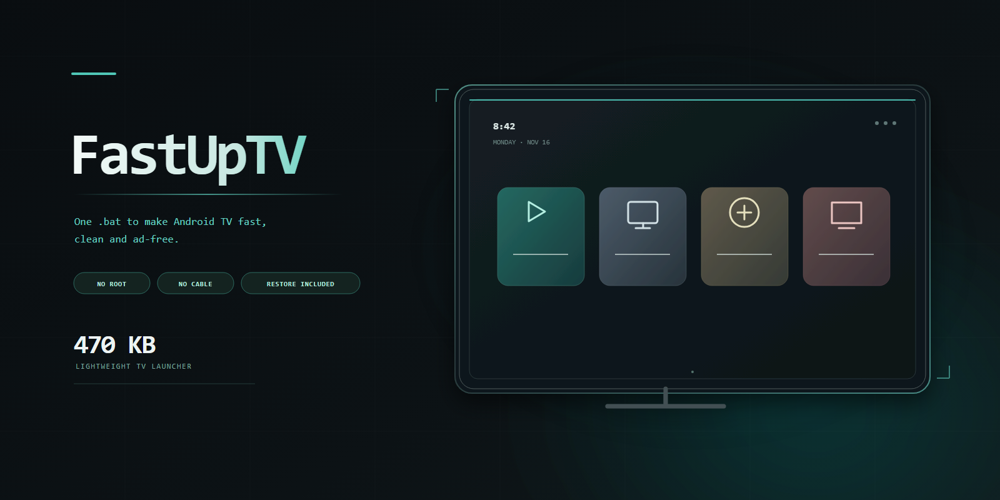
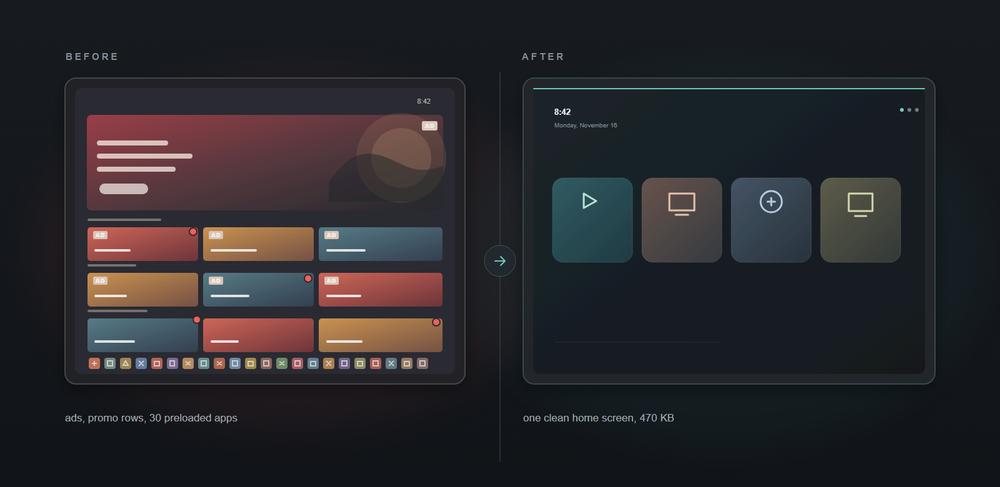

# FastUpTV

[](#requirements)
[](#tested-and-untested)
[](LICENSE)
[](#what-it-will-and-will-not-do)
[](https://github.com/dualwarez/FastUpTV/releases)
[](docs/COMPATIBILITY.md)

**Double-click one .bat and your slow Android TV becomes fast, clean and quiet. No root, no cable, no AI assistant.**

```
   BEFORE                                        AFTER
   PatchWall + ad rows                           a 470 KB home screen
   91 MB of vendor bloat in RAM                  that RAM back
   1522 ms to open YouTube                       950 ms
```

Built and measured on a real Mi TV 4A (Android 9, 1 GB RAM) - not on an emulator. Other brands run the
safe core list; [see exactly what is tested](#tested-and-untested) before you run it.




---

## Quick start - one path

**You need:** Windows 10/11, and the TV and PC on the same Wi-Fi. `adb` is already inside the zip.

1. **TV:** Settings -> About -> press **OK 7 times** on *Build* -> "You are now a developer"
2. **TV:** Settings -> Developer options -> **USB debugging** ON
   *(Xiaomi/Redmi: also switch on "ADB debugging" if you see it)*
3. **PC:** double-click **`setup.bat`**. It finds the TV, names it, lists the packages it will
   disable, and waits for **Y/n**
4. **Remote:** press **Home**

Expected result: home screen shows four big app tiles instead of ad rows, and the console ends with
"HO GAYA" plus the path of your backup.

Want to see the plan without changing anything? `.\scripts\setup.ps1 -DryRun`

---

## What it will and will not do

**It disables** vendor telemetry, ad/recommendation rows and preloaded apps - for the user profile,
on the TV, with `pm disable-user`. Typical run: 20-30 packages.

**It never** uninstalls, flashes, roots or reformats anything. Your apps keep their data. Core Android
packages, the keyboard, the setup wizard, the Play Store and whatever currently owns *Home* are
refused by the script itself, on any brand.

**Your way back:**

| | |
|---|---|
| Backup | `backups\<date>\` next to the script: every package, settings dumps, the old home app, and `session.log` |
| Undo everything | double-click **`restore.bat`** - re-enables the packages from that backup and puts the stock home screen back |
| Undo one app | TV: Settings -> Apps -> show system apps -> *Enable* |
| After you are done | turn **USB debugging OFF** in Developer options and choose **Revoke USB debugging authorizations** |

The backup folder is yours: keep it. If a run is interrupted, run `setup.bat` again - it takes a fresh
backup each time and never depends on the previous one.

---

## Tested and untested

| Device | Android | Result |
|---|---|---|
| Xiaomi Mi TV 4A 40" (`MiTV-AXSO0`) | 9 | **Tested** 2026-11-09 and 2026-11-16: discovery, backup, 30 packages disabled, launcher as Home, survives reboot, full restore, YouTube 1522 -> 950 ms |
| Google TV, TCL, Sony, Hisense, Philips, OnePlus, Nokia | 8+ | **Untested** - the safe core list only; template files wait for your report |

What "tested" means here, and how to add your TV: **[docs/COMPATIBILITY.md](docs/COMPATIBILITY.md)**.
Numbers and method: **[docs/BENCHMARKS.md](docs/BENCHMARKS.md)** - one device, repeated runs, limits
stated.

---

## From your phone

**A. Web UI - phone par buttons, PC par kaam (recommended)**

Double-click **`web.bat`** (needs Node.js, free). It prints something like:

```
phone par kholo:  http://192.168.1.20:8080/?t=6f3a1c9b2e4d
```

Open that on the phone (same Wi-Fi) and you get four big buttons: **TV dhoondo -> Plan dekho -> Clean karo -> Restore**.
The page is served by the PC, so the phone never needs a terminal, and every request needs the token
printed at startup.

**B. No PC at all (Termux)**

```bash
curl -fsSL https://raw.githubusercontent.com/dualwarez/FastUpTV/main/mobile/install.sh | bash
```

Installs adb + the repo in Termux and adds a **one-tap home-screen shortcut**. Details:
**[mobile/README.md](mobile/README.md)**.

Either way the TV-side steps are the same as the quick start above.

---

## The numbers (measured, not marketing)



| | Before | After |
|---|---|---|
| YouTube cold start | 1522 ms | **950 ms** (3 runs: 1065 / 944 / 963) |
| RAM held by vendor bloat | 91 MB | **0** |
| Free storage | 2.8 GB used | **2.1 GB used** (700 MB freed) |
| Packages disabled | 0 | **30** |

One TV, measured by hand, method and caveats in [docs/BENCHMARKS.md](docs/BENCHMARKS.md). A 2 GB TV
will show a smaller relative gain; a slower eMMC will show more. Nothing here is extrapolated to
brands that were not tested.

---

## What it does

| Step | What happens |
|---|---|
| **1. Finds the TV** | Scans your Wi-Fi for port 5555. No IP typing, no USB cable. |
| **2. Backs up** | Packages, settings and the current home app, into `backups\<date>\`, with `session.log`. |
| **3. Debloats** | `pm disable-user` on vendor telemetry, ad rows and preloaded junk - in small batches, verified per package. |
| **4. New home** | Installs a 470 KB native launcher, starts it, verifies Home really moved, and only then disables the old one. If the new one fails, nothing is disabled. |
| **5. Tunes** | Animation scales 0.5x, `pm trim-caches`, optional `pm compile -m speed` for the main apps. |

Optional extras the launcher brings: rotating wallpapers you supply, and a **weather screensaver**
that follows the real weather and time of day (sun with slow rays by day, stars and a moon at night,
rain streaks, thunder flashes, snow, haze).

---

## What exactly gets disabled

Only vendor telemetry, ad/recommendation rows and preloaded apps. A taste of the lists
(full files in [`lists/`](lists/)):

| Every Android TV (`lists/core.txt`) | Xiaomi / Redmi (`lists/xiaomi.txt`) |
|---|---|
| `com.google.android.tv.bugreportsender` | `com.miui.tv.analytics` |
| `com.google.android.feedback` | `com.xiaomi.statistic` |
| `com.google.android.tvrecommendations` | `com.mitv.tvhome.atv` (PatchWall) |
| `com.google.android.leanbacklauncher.recommendations` | `com.xm.webcontent` (promo rows) |
| `com.google.android.backdrop` | `com.xiaomi.floatingframe` |
| `com.google.android.play.games` | `com.xiaomi.mimusic2` |
| `com.google.android.videos` | `com.mitv.gallery` |

`setup.bat` prints the exact list for *your* TV before it touches anything, and refuses the dangerous
ones even if a contributed list asks for them.

---

## Why it works for normal people

- **One file.** No terminal, no Python, no AI assistant, no USB cable. Double-click, read the plan, press Y.
- **It finds the TV itself.** Wi-Fi scan, brand auto-detection, one backup before anything changes.
- **It explains itself.** Every step prints what it is doing and ends with what changed and where the backup is.
- **It can always be undone.** `restore.bat`, or the TV's own Settings -> Apps.
- **It refuses dangerous things.** Core Android, keyboard, setup wizard, Play Store, current Home.

---

## Manual use

```powershell
.\scripts\setup.ps1 -DryRun                    # show the plan, change nothing
.\scripts\setup.ps1 -NoLauncher                # debloat + tuning only
.\scripts\setup.ps1 -Compile                   # also AOT-compile the main apps
.\scripts\setup.ps1 -TvHost 192.168.1.50       # skip the scan
.\scripts\inspect.ps1                          # list packages (build your brand list)
.\scripts\restore.ps1                          # undo
```

`setup.bat` already passes `-ExecutionPolicy Bypass`; you never have to change PowerShell settings.

---

## Requirements

- Windows 10/11 (or an Android phone with Termux - see above)
- PC and TV on the same network
- `adb` - **already included** in `tools\platform-tools\`. Nothing to download.

---

## Contributing and support

The most valuable contribution is a **compatibility report** for a TV you own (2 minutes, no coding) -
it updates the tested table for everyone. Then a brand list: run `scripts\inspect.ps1`, add the junk to
`lists\<brand>.txt`, test a day, open a PR.

- [CONTRIBUTING.md](CONTRIBUTING.md) - rules for lists and code
- [Discussions](https://github.com/dualwarez/FastUpTV/discussions) - questions, "does it work on X?"
- [Issues](https://github.com/dualwarez/FastUpTV/issues) - bugs and compatibility reports
- [docs/TROUBLESHOOTING.md](docs/TROUBLESHOOTING.md) - TV not found, Home not changed, app broken

---

## Donate

If this saved your TV (or your evening), Bitcoin is welcome - it keeps the tool free for everyone:

```
15PdQ2Bi16JdR4ogsxD8Vg4vZfKfFXPjUY
```


<sub>Bitcoin (BTC) mainnet, P2PKH. Double-check the address in your wallet before sending - crypto
transfers cannot be reversed.</sub>

Star the repo if it helped - stars are what make the next person find it.
